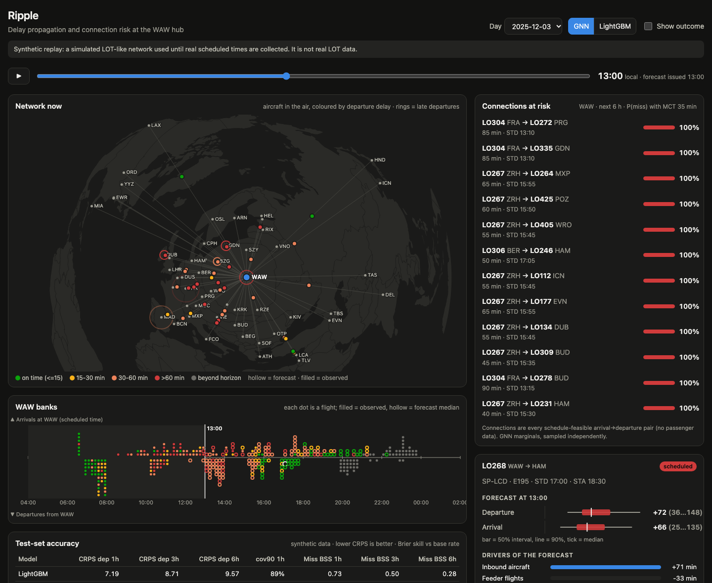

# Ripple

**Probabilistic forecasts of delay propagation and missed connections in the LOT Polish Airlines
network, built around the Warsaw Chopin (WAW) hub.**

Ripple forecasts the *distribution* of departure and arrival delay for every flight 1, 3 and 6 hours
ahead. It turns those distributions into P(missed connection) for arrival→departure pairs at WAW.
It also explains each forecast, for example *"inherited from the previous leg of SP-LxA, LO334 from
CDG, +42 min"*. The model is a dynamic heterogeneous graph neural network: flights are nodes, and
three kinds of edges carry delay between them (aircraft rotations, passenger connections, shared
airport slots and weather). It is compared head-to-head with a LightGBM baseline that gets
exactly the same inputs.

> **Status (2026-10-26):** the data collectors are running. Real scheduled times need an API key
> (see [Data](#data)), so every result below comes from a **synthetic LOT-like network**. The
> simulator has a known delay mechanism and is calibrated to real LOT rotation patterns from
> OpenSky. Synthetic numbers show that the method recovers propagation. They do **not** describe
> LOT's real operations.



## Why

- Reactionary delay, i.e. delay carried over from a previous flight of the same aircraft, made up
  roughly **40-48% of all delay minutes in Europe** in EUROCONTROL's 2025 CODA monthly reports.
  Most of the time, a flight is late because the flight before it was late.
- LOT runs a hub-and-spoke network through WAW (LOT Transfer Center). There, one late inbound can
  break a dozen onward connections, and one late aircraft carries its delay through every leg it
  flies for the rest of the day.
- LOT's on-time performance in 2024 was about **77.7%** (Cirium). Every point of OTP and every
  protected connection counts: rebooking, EU261 compensation, crew and slot knock-on effects.
- A forecaster that says *how likely* a connection is to fail, *how sure* it is, and *why* gives
  an operations controller something to act on: hold a departure, swap an aircraft, or re-protect
  passengers early.

## Quick start

```bash
uv sync                                   # Python 3.13, PyTorch, PyG, LightGBM
uv run ripple run-all                     # build synthetic data, train LightGBM + GNN + ablations, evaluate
uv run ripple demo                        # precompute dashboard replays for 4 test days
uv run ripple serve                       # http://127.0.0.1:8000 (serves the built dashboard)
npm --prefix app/web install && npm --prefix app/web run build   # once, to build the dashboard
```

Individual steps: `ripple build`, `ripple train lgbm|gnn|gnn_norot|...`, `ripple evaluate`.
Collectors: `scripts/install_collectors.sh` (launchd) and `ripple collect --help`.
Tests: `uv run pytest`. Lint: `uv run ruff check .`.

Everything runs on a laptop CPU. On a MacBook (M4) LightGBM trains in ~4 min and the GNN in
~2-3 min per epoch. CPU beats MPS for these small graphs; set `RIPPLE_DEVICE=mps` or `cuda` to
override, e.g. in Colab.

## Data

| Source | What | Access | Status |
|---|---|---|---|
| OpenSky `/states/all` | live positions around WAW, every 4.5 min → take-offs/landings, icao24, congestion | anonymous, 400 credits/day | **collecting** since 2026-10-26 |
| OpenSky `/flights/*` | first/last seen + airports per flight (actual times at both ends) | free account (OAuth client) | ready, waiting for credentials |
| OpenSky Zenodo flight lists | real LOT rotations 2019-2022 (used to calibrate the simulator) | public | Nov 2022 downloaded |
| OpenSky aircraft DB | icao24 → registration, type | public | `ripple collect aircraft-db` |
| IEM ASOS archive | METAR history for all 58 network airports | public | **collecting** daily |
| aviationweather.gov | TAF (IEM archives only US TAFs, so we build our own archive) | public | **collecting** hourly |
| AeroDataBox FIDS | **scheduled** + revised + runway times, registration | API key (free tier is enough) | ready, waiting for key |
| EUROCONTROL R&D archive | historical flights with filed/actual times and registrations | free research account | loader ready |

**Why not scrape the Chopin Airport website?** The airport's `robots.txt` allows crawling. But the
arrivals/departures board is served behind an F5 bot-defence challenge with a CAPTCHA, which is an
explicit technical "no" to automated access, so Ripple does not scrape it. The paid/keyed
alternatives (AeroDataBox, FlightAware AeroAPI, Aviationstack) are compared in
[`docs/data_sources.md`](docs/data_sources.md). A draft OpenSky academic-access application is in
[`docs/opensky_application.md`](docs/opensky_application.md).

### Synthetic network

`ripple/data/synthetic.py` simulates one year of a LOT-like network: 78 aircraft (787, 737 MAX,
E-jets, Q400), 58 real airports, about 340 legs per day, seven WAW banks aligned with real LOT
take-off peaks, nightstops, and great-circle block times. Weather is regional and seasonal (fog,
snow, thunderstorms, wind storms), and a TAF-like forecast is issued every 6 h. The delay process
combines primary delay, reactionary delay through rotations, de-icing/ATC slowdowns, ATFM at the
destination, regional ATC capacity days, slot congestion, and connection holds at WAW. It is
calibrated to arrival OTP15 76.6% (LOT 2024: 77.7%), with ~30% of delay minutes reactionary. Each
leg's true dominant cause is recorded, which makes explanations measurable.
[`notebooks/01_eda.ipynb`](notebooks/01_eda.ipynb) compares it with real OpenSky rotations.

## Method

**Prediction task.** Every 30 minutes (time *t*), every flight that has not departed yet and is
scheduled within [t - 3 h, t + 6.5 h] gets 19 quantiles (5%…95%) of departure and arrival delay.
Evaluation horizons: *t* = floor₃₀(STD - h) for h = 1, 3, 6 h.

**No leakage.** `FeatureStore.features(flight, t)` uses only what is known at *t*: the schedule,
actual times of flights that already departed or landed, "still on the ground although scheduled"
(a lower bound on delay), the latest METAR, and the latest TAF issued before *t*. A unit test
scrambles every actual time after *t* and checks that no feature changes. Splits are chronological
(70/15/15 % of days, with a one-day gap so rotations do not straddle splits). There is no month
feature, because the test months never occur in training.

**Graph.** At each snapshot the nodes are flights scheduled in [t - 10 h, t + 6.5 h]. Edges:

| edge | from → to | meaning | attribute |
|---|---|---|---|
| rotation | previous leg of the same tail → next leg | the aircraft carries its delay | turn slack |
| connection | WAW arrival → WAW departure, 35-150 min | passengers/bags (held departures) | scheduled slack |
| airport | same departure/arrival airport, ±40 min, 6 nearest each side | shared runway, weather, ATC | time offset |

The connection edges are the honest weak point. Without passenger data, *every*
schedule-feasible pair is treated as a potential connection. That is an upper bound on real
itineraries.

**Models.**
- **LightGBM** baseline: one quantile booster per (target, quantile) on the as-of features,
  including hand-made propagation features (projected reactionary delay down the rotation chain,
  feeder delays, recent airport delays).
- **GNN** (`ripple/models/gnn.py`): the same node features → MLP → 2× [GATv2Conv per edge type,
  summed, residual + LayerNorm] → **GRUCell** carrying each flight's hidden state across
  consecutive snapshots → two monotone quantile heads (cumulative softplus increments, so
  quantiles never cross). It is trained on sequences of 4 snapshots with pinball loss and early
  stopping on validation CRPS. PyTorch Geometric, CPU.
- **P(miss)** for each WAW pair: sample the inbound arrival delay and the outbound departure delay
  from their predicted quantile functions, count `arr - dep > slack - MCT` (MCT = 35 min). An
  inbound that already landed or is airborne uses its known delay (plus en-route variation).
- **Explanations**: occlusion attribution, the same for both models. Remove one group of evidence
  (inbound aircraft / feeder flights / weather / airport congestion) and the edges of that type,
  and measure how much the predicted median drops. On synthetic data this is scored against the
  simulator's true cause. Last-layer GATv2 attention is also exported (`GNNTrainer.attention`).

## Results (synthetic test set: last 15% of days, Nov-Dec)

RESULTS_PLACEHOLDER

## Limitations (read these before quoting any number)

- **Synthetic data.** All model results so far come from a simulator. It encodes my assumptions
  about how delay propagates, so a model that learns those assumptions will look good. The
  simulator is calibrated on punctuality and rotation structure, not on LOT's real delay causes.
- **No passenger data.** "Connections" are schedule-feasible pairs, and "missed" means the inbound
  landed less than 35 min (one MCT for all pairs) before the outbound left. Real MCTs differ
  (Schengen/non-Schengen, terminal changes), and real passengers are rebooked or wait.
- **Independence.** P(miss) treats inbound and outbound delays as independent given the
  forecasts. Holds make them positively correlated, so true P(miss) is lower for held flights.
- **Time definitions.** Real sources mix gate (off/on-block) and runway (take-off/landing) times.
  The adapters keep a `time_basis` flag, but delays measured either way differ by taxi time.
  EUROCONTROL's "filed off-block time" can already include delay updates, so delays against it
  are lower bounds.
- **Licensing.** AeroDataBox terms cap raw-data caching at 7 days without an exemption (see
  `docs/data_sources.md`). The OpenSky anonymous feed is coarse (4.5-min snapshots, one bounding
  box) and only covers the WAW area.
- **Collector uptime.** launchd jobs run only while the Mac is awake. Gaps are visible in
  `data/logs/` and in the daily files.
- **Weather severity** is a hand-made score from METAR/TAF fields, not an ATFM regulation feed.

## Roadmap

1. Keys → real schedules: OpenSky account + AeroDataBox (free tier). Backfill WAW with a
   one-month paid plan once the retention question is settled. Then `ripple build --source real`.
2. Re-run everything on real data (target: ≥ 3 months by March 2027) and report real results
   next to the synthetic ones.
3. EUROCONTROL R&D archive (2023-2024) for a longer historical training set with registrations.
4. Better connection model: LOT's published MCTs per terminal and Schengen status, and
   probabilistic holds.

## Repository layout

```
ripple/collect/     OpenSky, METAR/TAF, AeroDataBox, aircraft DB collectors
ripple/data/        schema, METAR decoder, real-data adapters, simulator, rotations, features
ripple/models/      LightGBM baseline, GNN (HeteroGATv2 + GRU)
ripple/eval/        metrics, connection risk, attribution, report
ripple/api/         FastAPI backend + LLM briefing
app/web/            React + TypeScript dashboard (Vite, d3-geo)
notebooks/          EDA (generated from notebooks/make_eda.py)
docs/               data-source decisions, OpenSky application draft, LinkedIn draft
scripts/            launchd installer, GNN sweep
reports/            generated results and figures
```

## References

- EUROCONTROL CODA, *Digest - All-causes delay to air transport in Europe*, monthly reports 2025.
- Cirium, *On-Time Performance Review 2024*.
- MSc thesis, TU Delft: dynamic GNN for a hub carrier, with rotations and connections as separate
  propagation channels.
- Graph attention for reactionary delay prediction on Swiss air traffic data.
- STPN: arXiv:2207.06959. CausalNet: arXiv:2407.15185.
- Brody, Alon, Yahav, *How Attentive are Graph Attention Networks?* (GATv2), ICLR 2022.
- Schäfer et al., *Bringing up OpenSky: A large-scale ADS-B sensor network for research*, IPSN 2014.

Data: OpenSky Network, Iowa Environmental Mesonet, NOAA Aviation Weather Center.
Ripple is an independent student project and is not affiliated with LOT Polish Airlines or
Warsaw Chopin Airport.
