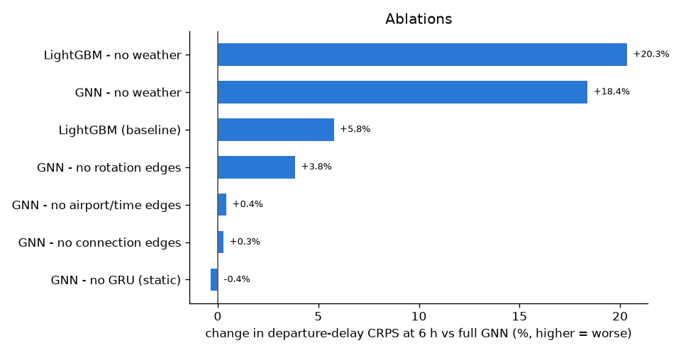
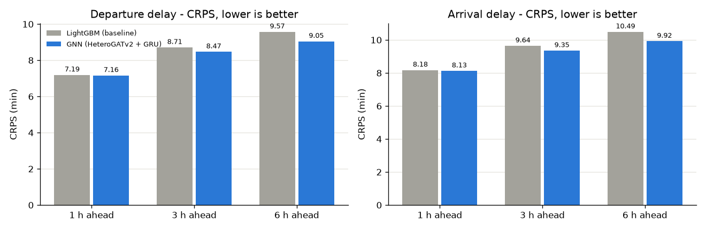
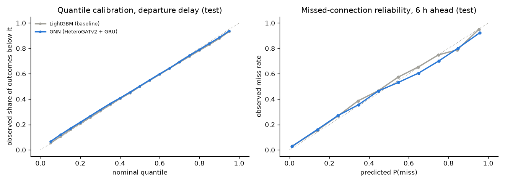

# Results - dataset `synthetic`

Test split = last 15% of days (chronological, 1-day gap). All numbers in minutes.
CRPS is approximated from 19 quantiles. Coverage should be close to 80% / 90%.
Both models are recalibrated post hoc on the validation split (per-quantile offsets);
`raw` columns show the uncalibrated model.

## Departure delay

| model | h | MAE | CRPS | cov80 | cov90 | width90 | raw CRPS | raw cov90 |
|---|---|---|---|---|---|---|---|---|
| LightGBM (baseline) | 1h | 9.01 | 7.19 | 78.3% | 88.7% | 37 | 7.19 | 88.0% |
| LightGBM (baseline) | 3h | 10.86 | 8.71 | 77.2% | 87.9% | 44 | 8.71 | 87.2% |
| LightGBM (baseline) | 6h | 11.92 | 9.57 | 76.1% | 87.3% | 46 | 9.57 | 86.6% |
| GNN (HeteroGATv2 + GRU) | 1h | 8.95 | 7.16 | 77.2% | 87.6% | 35 | 7.17 | 86.2% |
| GNN (HeteroGATv2 + GRU) | 3h | 10.53 | 8.47 | 76.3% | 87.1% | 40 | 8.48 | 85.7% |
| GNN (HeteroGATv2 + GRU) | 6h | 11.22 | 9.05 | 76.4% | 86.8% | 44 | 9.05 | 85.3% |
| LightGBM - no weather | 1h | 10.44 | 8.30 | 76.3% | 87.4% | 39 | 8.29 | 87.7% |
| LightGBM - no weather | 3h | 12.73 | 10.17 | 75.6% | 87.2% | 46 | 10.14 | 87.4% |
| LightGBM - no weather | 6h | 13.63 | 10.89 | 74.9% | 87.2% | 49 | 10.86 | 87.4% |
| GNN - no rotation edges | 1h | 8.99 | 7.22 | 76.9% | 87.7% | 36 | 7.22 | 86.7% |
| GNN - no rotation edges | 3h | 10.79 | 8.66 | 76.7% | 87.4% | 43 | 8.66 | 86.3% |
| GNN - no rotation edges | 6h | 11.71 | 9.40 | 76.5% | 87.2% | 45 | 9.40 | 86.4% |
| GNN - no connection edges | 1h | 8.93 | 7.16 | 78.2% | 88.4% | 36 | 7.16 | 87.4% |
| GNN - no connection edges | 3h | 10.58 | 8.48 | 77.4% | 87.6% | 41 | 8.49 | 86.3% |
| GNN - no connection edges | 6h | 11.27 | 9.07 | 76.1% | 86.6% | 44 | 9.08 | 85.2% |
| GNN - no airport/time edges | 1h | 9.04 | 7.25 | 77.4% | 88.1% | 36 | 7.27 | 86.2% |
| GNN - no airport/time edges | 3h | 10.70 | 8.59 | 76.4% | 87.1% | 41 | 8.61 | 85.1% |
| GNN - no airport/time edges | 6h | 11.30 | 9.09 | 76.2% | 86.8% | 43 | 9.10 | 84.8% |
| GNN - no weather | 1h | 10.04 | 8.02 | 76.4% | 87.1% | 37 | 8.02 | 86.8% |
| GNN - no weather | 3h | 12.33 | 9.87 | 75.8% | 86.8% | 45 | 9.87 | 86.6% |
| GNN - no weather | 6h | 13.32 | 10.71 | 74.7% | 86.8% | 48 | 10.72 | 86.5% |
| GNN - no GRU (static) | 1h | 9.00 | 7.24 | 77.3% | 87.7% | 36 | 7.25 | 85.7% |
| GNN - no GRU (static) | 3h | 10.53 | 8.47 | 76.4% | 87.0% | 41 | 8.48 | 84.8% |
| GNN - no GRU (static) | 6h | 11.21 | 9.02 | 77.1% | 87.3% | 45 | 9.02 | 84.9% |

## Arrival delay

| model | h | MAE | CRPS | cov80 | cov90 | width90 | raw CRPS | raw cov90 |
|---|---|---|---|---|---|---|---|---|
| LightGBM (baseline) | 1h | 10.40 | 8.18 | 78.2% | 88.8% | 43 | 8.18 | 87.8% |
| LightGBM (baseline) | 3h | 12.15 | 9.64 | 77.5% | 88.3% | 49 | 9.64 | 87.3% |
| LightGBM (baseline) | 6h | 13.22 | 10.49 | 76.6% | 87.8% | 51 | 10.49 | 87.0% |
| GNN (HeteroGATv2 + GRU) | 1h | 10.31 | 8.13 | 77.6% | 87.8% | 41 | 8.13 | 86.7% |
| GNN (HeteroGATv2 + GRU) | 3h | 11.77 | 9.35 | 77.3% | 87.4% | 45 | 9.36 | 86.3% |
| GNN (HeteroGATv2 + GRU) | 6h | 12.45 | 9.92 | 77.1% | 87.3% | 49 | 9.93 | 86.2% |
| LightGBM - no weather | 1h | 12.21 | 9.64 | 76.2% | 87.3% | 45 | 9.62 | 87.3% |
| LightGBM - no weather | 3h | 14.34 | 11.46 | 75.4% | 87.1% | 53 | 11.44 | 87.1% |
| LightGBM - no weather | 6h | 15.24 | 12.14 | 75.0% | 87.3% | 55 | 12.12 | 87.1% |
| GNN - no rotation edges | 1h | 10.35 | 8.16 | 77.4% | 88.4% | 41 | 8.16 | 87.2% |
| GNN - no rotation edges | 3h | 12.03 | 9.53 | 77.5% | 88.2% | 48 | 9.54 | 87.1% |
| GNN - no rotation edges | 6h | 12.92 | 10.27 | 76.6% | 87.6% | 50 | 10.28 | 86.6% |
| GNN - no connection edges | 1h | 10.32 | 8.13 | 78.6% | 88.9% | 41 | 8.13 | 87.6% |
| GNN - no connection edges | 3h | 11.82 | 9.38 | 77.8% | 88.3% | 47 | 9.38 | 87.1% |
| GNN - no connection edges | 6h | 12.52 | 9.98 | 77.0% | 87.6% | 49 | 9.99 | 86.3% |
| GNN - no airport/time edges | 1h | 10.46 | 8.24 | 77.7% | 88.2% | 42 | 8.24 | 87.8% |
| GNN - no airport/time edges | 3h | 12.03 | 9.53 | 77.2% | 87.5% | 46 | 9.54 | 87.0% |
| GNN - no airport/time edges | 6h | 12.59 | 10.01 | 77.0% | 87.5% | 48 | 10.01 | 87.1% |
| GNN - no weather | 1h | 11.76 | 9.30 | 76.3% | 87.5% | 44 | 9.30 | 86.9% |
| GNN - no weather | 3h | 14.00 | 11.13 | 76.1% | 87.3% | 52 | 11.14 | 86.8% |
| GNN - no weather | 6h | 14.94 | 11.94 | 74.4% | 87.1% | 55 | 11.96 | 86.6% |
| GNN - no GRU (static) | 1h | 10.38 | 8.19 | 77.4% | 88.0% | 41 | 8.20 | 85.9% |
| GNN - no GRU (static) | 3h | 11.83 | 9.37 | 77.3% | 87.9% | 46 | 9.38 | 86.0% |
| GNN - no GRU (static) | 6h | 12.49 | 9.92 | 77.2% | 87.7% | 50 | 9.93 | 85.6% |

## Missed connections at WAW (MCT 35 min, slack <= 150 min)

| model | h | Brier | Brier skill vs base rate | AUC | miss rate |
|---|---|---|---|---|---|
| LightGBM (baseline) | 1h | 0.0215 | 0.731 | 0.984 | 8.7% |
| LightGBM (baseline) | 3h | 0.0400 | 0.500 | 0.944 | 8.7% |
| LightGBM (baseline) | 6h | 0.0578 | 0.277 | 0.869 | 8.7% |
| GNN (HeteroGATv2 + GRU) | 1h | 0.0218 | 0.727 | 0.982 | 8.7% |
| GNN (HeteroGATv2 + GRU) | 3h | 0.0389 | 0.513 | 0.947 | 8.7% |
| GNN (HeteroGATv2 + GRU) | 6h | 0.0548 | 0.314 | 0.880 | 8.7% |
| LightGBM - no weather | 1h | 0.0220 | 0.725 | 0.988 | 8.7% |
| LightGBM - no weather | 3h | 0.0450 | 0.438 | 0.936 | 8.7% |
| LightGBM - no weather | 6h | 0.0659 | 0.176 | 0.824 | 8.7% |
| GNN - no rotation edges | 1h | 0.0219 | 0.727 | 0.980 | 8.7% |
| GNN - no rotation edges | 3h | 0.0398 | 0.502 | 0.943 | 8.7% |
| GNN - no rotation edges | 6h | 0.0577 | 0.279 | 0.872 | 8.7% |
| GNN - no connection edges | 1h | 0.0218 | 0.727 | 0.982 | 8.7% |
| GNN - no connection edges | 3h | 0.0391 | 0.511 | 0.943 | 8.7% |
| GNN - no connection edges | 6h | 0.0556 | 0.304 | 0.879 | 8.7% |
| GNN - no airport/time edges | 1h | 0.0226 | 0.717 | 0.978 | 8.7% |
| GNN - no airport/time edges | 3h | 0.0396 | 0.505 | 0.941 | 8.7% |
| GNN - no airport/time edges | 6h | 0.0564 | 0.295 | 0.875 | 8.7% |
| GNN - no weather | 1h | 0.0221 | 0.724 | 0.986 | 8.7% |
| GNN - no weather | 3h | 0.0446 | 0.442 | 0.935 | 8.7% |
| GNN - no weather | 6h | 0.0636 | 0.205 | 0.840 | 8.7% |
| GNN - no GRU (static) | 1h | 0.0222 | 0.722 | 0.981 | 8.7% |
| GNN - no GRU (static) | 3h | 0.0390 | 0.513 | 0.946 | 8.7% |
| GNN - no GRU (static) | 6h | 0.0555 | 0.306 | 0.879 | 8.7% |

